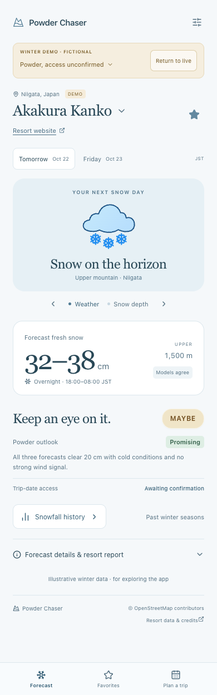
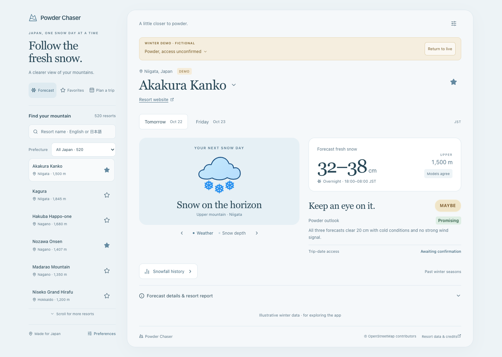

# Test winter decisions before the season

Open **Preferences → Winter demo → Winter test scenario**. Choose a scenario and return to the forecast. The same choice applies to Forecast, Favorites and Plan a trip, survives reloads and works offline after the app has installed. Use **Return to live** in the banner to resume actual model forecasts. Live remains the default for new visitors.

Every scenario is fictional, including its snow, observations and operations. Explicit test cases apply the same conditions to the selected catalogue resort so behaviours are easy to compare; these are not resort-specific forecasts. Original **Resort examples** retain the eight curated examples and their differences between dates and elevations.

## Scenario checklist

The following results use the default 20 cm threshold. Changing the threshold intentionally changes the verdict.

| Choice | Powder outlook | Trip-date access | Overall result / useful check |
| --- | --- | --- | --- |
| Resort examples | Varies by resort/date/height | Fictional confirmed open | Explore the original eight examples |
| Cold powder day | Promising | Fictional confirmed open | Go |
| Light snowfall | Low | Fictional confirmed open | Skip |
| Powder, access unconfirmed | Promising | Awaiting confirmation | Maybe; good weather is still visible |
| Conflicting forecasts | Borderline | Fictional confirmed open | Maybe; compare the three snowfall amounts |
| Snow above, rain below | Promising upstairs, Borderline at base | Fictional confirmed open | Compare Upper and Base in Preferences |
| Strong wind and lift hold | Borderline | Fictional lift hold | Maybe; weather and access both show concerns |
| Terrain closed | Promising | Fictional closed terrain | Skip despite good snowfall |
| Outdated reports | Unknown | Fictional prior open report | Maybe; forecast/report timestamps are 26 hours old |
| Missing forecast data | Unknown | Awaiting confirmation | Maybe; two models and observations remain unknown |
| Connection failure | Unavailable | No loaded forecast | Simulated error with scenario-change and live recovery controls |

The banner labels every view **WINTER DEMO · FICTIONAL** and names the active case. Model labels also say simulated. Scenario tests do not request live weather or official reports. Changing the source to live cancels obsolete comparisons, hides demo values and waits for a real response; a failed live request shows an error.

## What the two signals mean

**Powder outlook** checks whether three distinct complete forecasts cover the selected 18:00–08:00 JST window, are fresh, clear the personal snowfall threshold and support cold snow without significant rain or strong wind. A broad snowfall disagreement or weather concern is Borderline. Missing or outdated inputs are Unknown. Agreement is not a probability of powder.

**Trip-date access** independently checks the operations date. An open report from another date cannot confirm the selected ski morning. The overall Go / Maybe / Skip also considers access, so Promising + Awaiting confirmation remains Maybe; verified closure remains Skip. Live snapshots currently have unconfirmed future access. Morning observations retain their own dates and do not turn today's open lifts into tomorrow's confirmation.

## Observation coverage

The morning check now supports Rusutsu snow/lifts, Madarao snow, Happo-one Kurobishi depth and Nozawa lift updates. Only measurements with a stated 24-hour window populate reported fresh snow. Happo's generic snowfall field has no verified window; Nozawa's snow board has an incomplete date and a different reporting window. Those readings stay unknown. Akakura's off-season pages currently have no usable dated snow board. See [sources, timestamps and collection](resort-reports.md).

The snow-depth hero still uses fictional observations in Winter Demo. Live station-specific depths stay in the morning check with their station and timestamp; they are not assigned to the chosen model height.

## Verification for release 0.1.8

Verified on 21 October 2026:

- All 209 behavioural tests, TypeScript checks and the production build pass. Tests include scenario routing without network calls, preference migration, cancellation, independent outlook/access evaluation and captured official-source parser boundaries.
- Chrome exercised all eleven choices through Forecast, Favorites and Plan a trip, both rain/snow heights, reload persistence, stale/closed/held reports and a return to live using a controlled provider response. No demo weather/report requests or page errors occurred.
- A 45-screen accessibility/layout sweep at 320, 390, 851, 1,024 and 1,440 px found no automated WCAG A/AA violations, horizontal overflow or out-of-bounds main controls. Mobile and desktop screens were also visually inspected. Automated checks are not a complete accessibility assessment.
- Real official pages were collected with their original dates. Happo's Kurobishi board reported 0 cm on 21 October; Nozawa's lift board still retained 6 May. Fetch time never updates the source's publication time.

| Mobile | Desktop |
| --- | --- |
|  |  |

These checks validate behaviour and data handling before winter. Assessing forecast skill requires forecasts saved as they were available before a trip and compatible later observations, matched by location, elevation, accumulation window and lead time. Seasonal history and retrospective model estimates alone cannot establish what was forecast in advance. Historical replay, forecast-change tracking and alerts are not included in this release.
